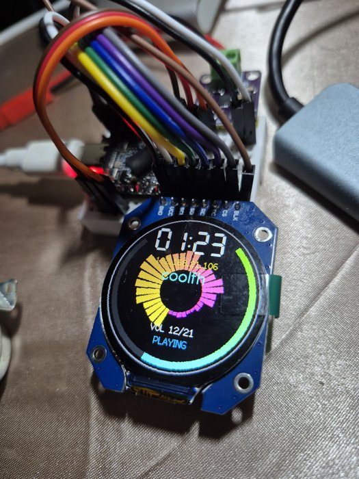

# NetRadio (ESP32-S3 + GC9A01 + MAX98357)

Internet radio on an ESP32-S3 with a 240x240 round GC9A01 display and a MAX98357 I2S amplifier.

Shows time, WiFi status and IP address, station name, volume level, playback state, and a circular spectrum visualizer.



## Hardware

| Part | Pin |
| --- | --- |
| GC9A01 SCL | GPIO13 |
| GC9A01 SDA | GPIO12 |
| GC9A01 RES | GPIO11 |
| GC9A01 DC | GPIO10 |
| GC9A01 CS | GPIO9 |
| GC9A01 BLK | 3.3V |
| MAX98357 LRC | GPIO1 |
| MAX98357 BCLK | GPIO2 |
| MAX98357 DIN | GPIO3 |

Full pin reference: `pin.txt`. Pin constants: `src/config.h`.

## Setup

1. Copy `src/secrets.example.h` to `src/secrets.h` and fill in your WiFi SSID and password.
2. Build and flash:

```
pio run -t upload
pio device monitor
```

## Web interface

The device is reachable at `http://<device-ip>/` (shown on the display) or `http://netradio.local/` via mDNS.

Controls:

- play / pause / stop
- pick a station from the list
- adjust the volume (0–21)

API:

| Endpoint | Method | Description |
| --- | --- | --- |
| `/` | GET | control page |
| `/api/stations` | GET | station names as JSON |
| `/api/status` | GET | IP, station, volume, state, time |
| `/api/station?i=N` | POST | select station `N` |
| `/api/volume?v=N` | POST | set volume (0–21) |
| `/api/play` | POST | resume (restarts the stream if stopped) |
| `/api/pause` | POST | pause / resume toggle |
| `/api/stop` | POST | stop playback (no auto-retry) |

## Configuration

- Stations: `STATIONS[]` in `src/config.h`
- Timezone: `TZ_INFO` in `src/config.h` (default `ICT-7`)
- mDNS host name: `MDNS_HOST` in `src/config.h` (default `netradio`, shown on the display)
- Display setup: `src/lgfx_config.h`
- Text opacity: `TEXT_ALPHA` in `src/ui.cpp` (0–255)
- Visualizer spin speed: `BAR_SPIN_DEG_PER_MS` in `src/ui.cpp`

## Notes

- PSRAM must be enabled (the audio library allocates its stream buffer there):
  `board_build.arduino.memory_type = qio_qspi` and `board_build.psram_type = qspi` in `platformio.ini`.
- Only ASCII text is rendered; the display fonts have no Thai glyphs.
- Station URLs go stale over time. If a station stays in `BUFFERING` or `STREAM ERROR`, replace its URL in `src/config.h`.
